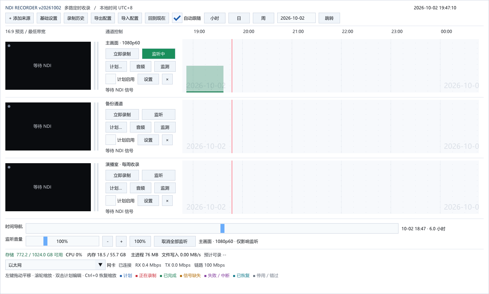

<div align="center">


# NDI Recorder

**Windows 多路 NDI 定时收录 / 录制工具**

发现网络中的 NDI 源，为每路通道独立配置录制参数，按计划自动启停，
支持断流容错、实时监测与 7×24 小时长期运行诊断。

[](LICENSE)
[](docs/ACCEPTANCE.md)
[](CMakeLists.txt)
[](CMakeLists.txt)

**中文** · [English](README_EN.md)



</div>

## 目录

- [简介](#简介)
- [功能特性](#功能特性)
- [快速开始](#快速开始)
- [时间轴状态配色](#时间轴状态配色)
- [录制文件与命名](#录制文件与命名)
- [命令行工具](#命令行工具)
- [从源码构建](#从源码构建)
- [项目结构](#项目结构)
- [文档](#文档)
- [当前状态与计划](#当前状态与计划)
- [许可证](#许可证)

## 简介

NDI Recorder 是一个面向**定时收录**场景的 Windows 桌面程序：电视台节目收录、直播活动备份、演播室多路信号录制等需要"到点自动开始、到点自动结束、出问题能自己恢复"的场合。

设计上把可靠性放在第一位：主进程只负责界面和调度，每路录制交给独立的工作进程执行；单个工作进程崩溃不影响其他通道，也不会拖垮界面。全链路缓冲都有硬上限，磁盘空间不足时宁可停录也不删文件。

技术栈：C++20 · CMake · Win32 · D3D11 · Dear ImGui · FFmpeg · SQLite · NDI SDK

## 功能特性

### 📡 多路通道与来源管理

- 自动发现局域网内的 NDI 源，列表持续刷新；也可粘贴完整源名（如 `HOST (Camera 1)`）或在基础设置中配置逗号分隔的**额外发现 IP**
- 每路通道**独立**设置输出编码、码率、分辨率、帧率、录入声道、分段时长
- 空闲预览始终请求 **NDI 最低带宽流**（上限 15 fps），录制开始前约 5 秒才预热完整接收器，尽量减轻网络与发送端负担
- 每路固定 16:9 黑边预览 + 左右声道电平表
- 通道参数修改只影响**后续任务**；运行中的任务保持启动时的参数快照
- 「恢复默认参数」一键回到基础设置中的新通道默认值；删除通道需确认，且**保留已录制文件**

### 🎬 录制与编码

- **H.264 / MP4**：默认 20 Mbps；自动按 NVENC → QSV → AMF → Media Foundation 顺序逐项**实际试编码**选择可用编码器；碎片化封装，分段在关键帧处完成
- **FFV1 / MKV 无损**：保存 NDI SDK 解码后的像素与浮点音频，生成逐帧 `.checksums.json` 校验摘要
- **去隔行与场序**：1080i50 自动转 1080p50（bwdif 双场去隔行），场序可选自动 / 顶场优先 / 底场优先
- **延时摄影**：N 倍快放或每隔 S 秒取一帧、自定义成片帧率（仅 H.264，无音轨）
- **自动分段**：默认每 60 分钟一段（1–1440 分钟可调），按通道、日期自动归档
- **录制带宽可选**：每路可独立选择最高质量或最低带宽接收
- 分辨率/帧率设为 0 表示跟随源；异常退出**绝不删除录像**，未封装完成的文件保留 `_recording_` 原名

### 🛡️ 断流容错与自动恢复

- 视频缺失自动补黑帧、音频缺失自动补静音，两路信号分别处理；恢复后继续写入，缺失区间登记到历史与日志
- 开录时**等待真实首帧**，不假定输入规格、不生成占位文件；等待期间可随时取消
- 源时间码与接收时钟持续漂移自动校正；连续补黑超过 10 秒交由恢复策略重启工作进程
- 源规格变化时结束当前工作进程并有限重启，从新片段继续
- 连续失败自动重试 3 次（2/4/8 秒退避）；连续正常录制 30 秒或正常结束后重置计数；仍失败则停用并提示，避免无限重启

### 📅 定时计划与时间轴

- 计划类型：**指定日期一次 / 每天 / 每周指定星期**；支持跨午夜、24 小时计划、跳过单轮、停用、例外日期
- 同一路重叠计划在保存时即被阻止；修改重复计划作用于整个系列
- 「立即录制」的手动需求与计划需求互不影响，可叠加
- 程序重启后，仍在有效期内的计划自动从当前时刻继续，错过时段记为 missed
- 合并时间轴：上半计划、下半实际，拖动平移、滚轮缩放（1 分钟至 14 天）、小时/日/周视图、日期跳转
- **自动跟随**：当前时刻（红色竖线）保持在可视范围约 1/6 处，手动浏览自动暂停，一键「回到现在」
- 新建计划带「今天 / 明天 / 下个整点」与「录制 1/2/4 小时」快捷填写

### 🔊 音频：录制增益与监听

- **录制增益**：每路 -24 ~ +24 dB 实时调整（+6 dB 约两倍振幅），录制中可调、不中断任务，松开即保存
- **监听音量**：0–400% 独立控制，只影响本机扬声器/耳机，**不改变录制文件**；底部可一键「取消全部监听」
- 监听同时仅一路、默认静音，跟随所选声道对与当前任务参数快照
- 录入声道自由配对（通常 1/2，多声道源可选 3/4 等），单声道源自动复制到左右
- 参考电平换算：H.264 默认按 NDI SMPTE 参考电平 -20 dB，EBU 可选 -14 dB；FFV1 无损不施加任何增益

### 📊 实时监测与统计

- 每路「监测」弹窗分类计数：SDK 视频/音频丢弃、接收队列溢出、处理缓存溢出、场配对失败、重复画面、黑画面填充、静音填充
- 文件写入速度每秒采样：近 5 秒、任务平均、采样峰值、累计字节
- 「最近 60 秒」滚动窗口与「任务累计」两种视图；录制历史中可查看同一任务全部分段汇总
- 监测**不新增接收器、不播放声音、不逐帧分析**，实测 CPU 开销差异在波动范围内
- 主进程每约 5 秒持久化快照；任务异常中断时保留最后快照并标记为部分统计

### 🔧 7×24 长期运行与现场诊断

- `Start-24h-Debug.cmd` / `Stop-24h-Debug.cmd`：每 30 秒采样进程 CPU、内存、句柄、线程、I/O 与磁盘空间；每 10 分钟在线备份数据库与日志；工作进程每分钟记录接收时效与时钟偏差
- `Inspect-Recording.cmd`：离线完整解码录像，检测黑场（≥2 秒且 ≥98% 像素低于阈值）、静音（低于 -50 dB 持续 ≥2 秒）与解码错误
- 诊断不额外接收 NDI、不逐帧分析、不自动上传；日志副本上限 256 MiB，一个会话最长 30 天

### 🧱 可靠性工程

- 每路录制运行在独立工作进程（`--worker` 模式），通过命名共享内存交换状态；主进程崩溃不遗留录制进程（kill-on-close Job Object）
- 全链路有界缓冲：NDI 接收队列（128 MB / 128 项 / 500 ms）、滤镜后视频队列（128 MB / 64 帧）、音频块队列（128 项）、日志队列（2048 条）
- 编码持续落后超 2 秒自动止损；工作进程心跳 30 秒无更新即终止重启
- 磁盘**安全余量**保护（默认 10 GB）：低于余量停止受影响录制，不自动删除文件，空间恢复后一键「恢复任务」
- SQLite（WAL + FULL 同步 + 事务）保存配置与历史；日志按天及进程轮转（单文件 16 MB）

### 🖥️ 界面与系统集成

- 白色主题、直角控件、统一控件高度、高对比度文字；小窗口工具栏自动换行，通道与弹窗可滚动
- **Per-Monitor V2** 高 DPI：跨屏按当前显示器 DPI 重绘；软件缩放 80%–150% 叠加系统缩放，立即预览
- 缩放恢复三保险：**Ctrl+0**、按住 **Shift** 启动、`--reset-ui-scale` 命令行
- 单实例运行（重复启动只激活已有窗口）；系统托盘驻留（双击恢复、右键退出）；可选登录自启
- 底部状态栏：存储余量、预计可录时长、CPU/内存、主进程内存、实时写入速度、网卡收发与链路速率
- **配置导出/导入**：JSON 格式，导出前明示包含内容；导入时先检查后合并，支持只选计划/通道/基础设置，冲突即阻止，绝不静默覆盖

## 快速开始

### 系统要求

- Windows 10 / 11 x64
- NDI 运行环境（发布包已附带 NDI 运行库）
- 可写的程序目录与录像目录

### 安装

1. 从 Releases 下载 `ndi-recorder-vYYYYMMDD-windows-x64.zip`
2. **完整解压**到可写目录（同目录 DLL 是运行必需的）
3. 运行 `ndi-recorder.exe`

### 五分钟上手

1. 点击 **「+ 添加来源」**，从发现列表选择 NDI 源（或粘贴完整源名）
2. 点击该路 **「设置」** 确认录制参数，保存
3. 点击 **「立即录制」** 开始；或点 **「计划…」** 建立定时计划
4. 时间轴下半部出现红色录制块，结束后变绿；**双击**即可打开文件
5. 首次使用请录一小段并播放，验证声道、场序、音画同步与码率

> 详细操作见 [使用说明](docs/USER_GUIDE.md)。

## 时间轴状态配色

| 颜色 | 含义 |
|---|---|
| 🔵 蓝 | 计划 |
| 🔴 红 | 正在录制 |
| 🟢 绿 | 已完成 |
| 🟠 琥珀 | 信号缺失 |
| 🟣 紫 | 失败 / 中断 |
| 🩵 青 | 已恢复 |
| ⚪ 灰 | 停用 / 错过 |

## 录制文件与命名

```text
录像根目录/
└── 通道名/
    └── 日期/
        └── 20261002_080000-20261002_090000_任务标识_段号.mp4
```

- 成功封装的文件名包含完整的开始/结束日期时间，跨午夜可辨识；无损为 `.mkv`
- 写入中的文件含 `_recording_`，成功后自动改名并更新历史
- 绝不覆盖已有文件；分段在关键帧处完成，实际长度可能略超设定值

## 命令行工具

| 命令 | 用途 |
|---|---|
| `ndi-recorder.exe` | 启动主程序 |
| `ndi-recorder.exe --tray` | 启动并缩到系统托盘 |
| `ndi-recorder.exe --reset-ui-scale` | 恢复软件缩放为 100%（程序已运行时通知已有窗口） |
| `ndi-recorder.exe --list-sources out.json` | 列出发现的 NDI 源 |
| `ndi-recorder.exe --inspect-source <源名> out.json` | 检查指定 NDI 源 |
| `ndi-recorder.exe --probe-encoders out.json` | 探测本机可用编码器 |
| `ndi-recorder.exe --test-source <名称> <50\|60> <秒>` | 启动内置测试源（1080i50 / 1080p60，带同步脉冲音） |
| `ndi-recorder.exe --diagnostic-export <数据目录> <输出目录>` | 备份配置数据库 |

## 从源码构建

需要 Visual Studio 2022（C++ 桌面开发）、Windows SDK、CMake 3.24+，以及按 [构建依赖](docs/BUILDING.md) 准备的 vendor 目录（NDI SDK、FFmpeg、Dear ImGui、SQLite、nlohmann JSON）。第三方依赖不随源码仓库分发。

```powershell
# 一步完成 Release 构建、回归测试、安装目录及 ZIP 打包
powershell -NoProfile -ExecutionPolicy Bypass -File tools/pack.ps1

# 或分步执行
cmake -S . -B build -G "Visual Studio 17 2022" -A x64
cmake --build build --config Release --parallel 6
ctest --test-dir build -C Release --output-on-failure
cmake --install build --config Release --prefix dist/ndi-recorder-windows-x64
cpack --config build/CPackConfig.cmake -C Release
```

版本号为 `vYYYYMMDD` 日期格式，发布时修改 `CMakeLists.txt` 中的 `APP_RELEASE_DATE`，统一生成窗口标题、EXE 版本资源、manifest 与 ZIP 名称。

## 项目结构

```text
src/         # 主程序：core（模型/计划/SQLite）、ndi（SDK 对接）、media（编码封装）、manager（工作进程管理）、ui（界面）
tests/       # core / manager 单元测试与音画同步检查器
tools/       # 构建打包脚本、冒烟测试与诊断工具
docs/        # 使用说明、构建依赖、架构、验收记录
assets/      # 应用图标
vendor/      # 第三方依赖（不入库，见 docs/BUILDING.md）
```

## 文档

| 文档 | 内容 |
|---|---|
| [使用说明](docs/USER_GUIDE.md) | 安装、界面、通道、计划、音频、监测、诊断与排障 |
| [构建依赖](docs/BUILDING.md) | 依赖版本、校验值与完整构建打包流程 |
| [架构](docs/ARCHITECTURE.md) | 进程模型、媒体链路、有界资源与失败策略 |
| [验收记录](docs/ACCEPTANCE.md) | 已执行测试、证据与尚未覆盖范围 |
| [第三方依赖许可](THIRD_PARTY_NOTICES.md) | 各组件许可证与再分发要求 |

## 当前状态与计划

当前为 **0.1 开发预览版（v20261002）**。本机 Windows 10 上的构建、单元 / 集成 / 界面回归已通过（见 [验收记录](docs/ACCEPTANCE.md)）。

尚未完成：

- 目标硬件上的四路 24 / 72 小时压力测试
- 真实广播设备的多声道、场序验收
- Windows 11 实机验证（当前未覆盖，不视为已验收）
- H.265 编码、Windows 服务、多机 genlock（本版不提供，H.265 在后续计划中）

## 许可证

本项目代码以 [MIT License](LICENSE) 发布。第三方组件保留各自许可，详见 [THIRD_PARTY_NOTICES.md](THIRD_PARTY_NOTICES.md)。

NDI 是 Vizrt NDI AB 的注册商标。本项目不是 NDI 官方或认证产品。
