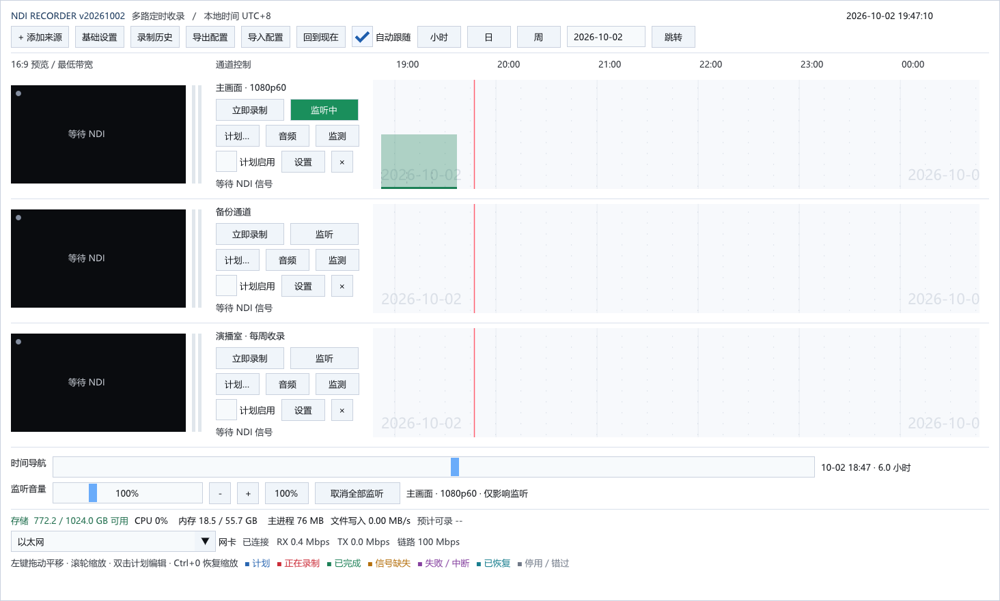

<div align="center">


# NDI Recorder

**A multi-channel NDI scheduled recording tool for Windows**

Discover NDI sources on the network, configure each channel independently,
start and stop recordings on schedule, tolerate outages,
monitor every channel live, and collect 7×24 long-run diagnostics.

[](LICENSE)
[](docs/ACCEPTANCE.md)
[](CMakeLists.txt)
[](CMakeLists.txt)

[中文](README.md) · **English**



</div>

> **Note:** the application UI is Chinese. This document describes the same features in English.

## Table of contents

- [Introduction](#introduction)
- [Features](#features)
- [Quick start](#quick-start)
- [Timeline status colors](#timeline-status-colors)
- [Recording files and naming](#recording-files-and-naming)
- [Command-line tools](#command-line-tools)
- [Build from source](#build-from-source)
- [Project layout](#project-layout)
- [Documentation](#documentation)
- [Current status and roadmap](#current-status-and-roadmap)
- [License](#license)

## Introduction

NDI Recorder is a Windows desktop application built for **scheduled ingest**: TV program recording, live-event backup, multi-channel studio capture — anywhere you need "start on time, stop on time, recover by itself when something breaks".

Reliability comes first in the design: the main process only runs the UI and scheduling; each channel records in its own worker process. A crashing worker never affects other channels or the interface. Every buffer in the pipeline has a hard limit, and when disk space runs low the recorder stops rather than deleting anything.

Tech stack: C++20 · CMake · Win32 · D3D11 · Dear ImGui · FFmpeg · SQLite · NDI SDK

## Features

### 📡 Channels and sources

- Automatic NDI source discovery on the LAN with continuous refresh; paste a full source name (e.g. `HOST (Camera 1)`) or configure comma-separated **extra discovery IPs**
- **Per-channel** output codec, bitrate, resolution, frame rate, channel pair and segment length
- Idle preview always requests the **lowest-bandwidth NDI stream** (capped at 15 fps); the full receiver warms up only ~5 seconds before recording, keeping network and sender load low
- Fixed 16:9 letterboxed preview plus left/right audio level meters per channel
- Parameter changes apply to **future tasks**; a running task keeps the snapshot it started with
- "Restore defaults" reverts recording parameters to the new-channel defaults from base settings; channel deletion asks for confirmation and **keeps existing recordings**

### 🎬 Recording and encoding

- **H.264 / MP4**: 20 Mbps by default; the encoder is picked by **actual trial encoding** in the order NVENC → QSV → AMF → Media Foundation; fragmented MP4, segments cut on keyframes
- **FFV1 / MKV lossless**: keeps the pixels and floating-point audio decoded by the NDI SDK, with a per-frame `.checksums.json` verification digest
- **Deinterlacing and field order**: 1080i50 becomes 1080p50 (bwdif double-rate deinterlacing); field order selectable: auto / top-first / bottom-first
- **Timelapse**: N× speed or one frame every S seconds with a custom output frame rate (H.264 only, no audio track)
- **Automatic segmentation**: every 60 minutes by default (1–1440 adjustable), filed by channel and date
- **Selectable receive bandwidth**: highest quality or lowest bandwidth per channel
- Resolution/frame rate 0 means "follow source"; abnormal exits **never delete recordings** — unfinished files keep their `_recording_` name

### 🛡️ Outage tolerance and automatic recovery

- Missing video is filled with black frames and missing audio with silence, handled independently; writing resumes after the signal returns, and gaps are logged to history and logs
- Waits for the **real first frame** when recording starts — no assumed input format, no placeholder files; cancellable while waiting
- Continuous drift between the source timecode and the receive clock is corrected automatically; more than 10 s of uninterrupted black-fill restarts the worker through the recovery policy
- Source format changes end the current worker and restart within limits, continuing in a new segment
- Automatic retry on repeated failures (2/4/8 s backoff, up to 3 times); the counter resets after 30 s of healthy recording or a normal finish; persistent failure disables the task with a prompt instead of restarting forever

### 📅 Schedules and timeline

- Schedule types: **one-shot on a date / daily / weekly on selected weekdays**; overnight and 24-hour schedules, skip-one-occurrence, disable, exception dates
- Overlapping schedules on the same channel are rejected at save time; editing a repeating schedule affects the whole series
- The "Record now" manual demand coexists with schedule demand
- After a program restart, schedules still in range resume from the current moment; missed periods are marked as missed
- Unified timeline: schedules on the upper half, actual recordings on the lower half; drag to pan, wheel to zoom (1 minute to 14 days), hour/day/week views, date jump
- **Auto-follow**: the current-time red line stays at about 1/6 of the visible range; manual browsing pauses it, one click on "Back to now" resumes
- Quick-fill for new schedules: today / tomorrow / next hour start, and 1/2/4-hour durations

### 🔊 Audio: record gain and monitoring

- **Record gain**: -24 to +24 dB per channel, adjustable live (+6 dB ≈ double amplitude) — even mid-recording, without interrupting the task; saved on release
- **Monitor volume**: 0–400%, independent; affects only the local speaker/headphone and **never the recorded file**; one-click "mute all monitoring" at the bottom
- One channel monitored at a time, muted by default; follows the selected channel pair and the running task's parameter snapshot
- Freely paired input channels (usually 1/2, 3/4 etc. on multichannel sources); mono sources are duplicated to left/right
- Reference level conversion: H.264 uses the NDI SMPTE reference level at -20 dB by default (EBU -14 dB optional); FFV1 lossless applies no gain at all

### 📊 Live monitoring and statistics

- Per-channel "Monitor" window with categorized counters: SDK video/audio drops, receive-queue overflows, processing-cache overflows, field-pairing failures, repeated frames, black fills, silence fills
- File write speed sampled every second: last 5 s, task average, sample peak, cumulative bytes
- "Last 60 seconds" rolling window and "task cumulative" views; per-task aggregates across all segments available from recording history
- Monitoring **adds no receiver, plays no audio, analyzes no frames**; measured CPU difference stays within run-to-run noise
- The main process persists snapshots about every 5 seconds; interrupted tasks keep the last snapshot, marked as partial statistics

### 🔧 7×24 operation and field diagnostics

- `Start-24h-Debug.cmd` / `Stop-24h-Debug.cmd`: sample process CPU, memory, handles, threads, I/O and free disk space every 30 s; online database and log backups every 10 minutes; workers log receive freshness and clock deviation every minute
- `Inspect-Recording.cmd`: offline full-decode inspection of recordings for black frames (≥2 s with ≥98% of pixels below threshold), silence (below -50 dB for ≥2 s) and decode errors
- Diagnostics add no extra NDI receiver, do no per-frame analysis and upload nothing; the log copy is capped at 256 MiB and one session runs up to 30 days

### 🧱 Reliability engineering

- Each channel records in a dedicated worker process (`--worker` mode) exchanging state over named shared memory; a dying main process leaves no orphaned recorder behind (kill-on-close Job Object)
- Bounded buffers throughout: NDI receive queue (128 MB / 128 items / 500 ms), post-filter video queue (128 MB / 64 frames), audio block queue (128 items), log queue (2048 entries)
- The worker stops itself if encoding lags more than 2 s; a worker without a heartbeat for 30 s is terminated and restarted
- Disk **safety margin** (10 GB by default): affected recordings stop below the margin, nothing is auto-deleted, and one click on "Resume task" continues once space is back
- Configuration and history in SQLite (WAL + FULL sync + transactions); logs rotate daily and per process (16 MB per file)

### 🖥️ Interface and system integration

- White theme, square-cornered controls, uniform control heights, high-contrast text; toolbars wrap in small windows; channels and dialogs scroll
- **Per-Monitor V2** high-DPI: redraws at the current monitor's DPI when moved across screens; in-app 80%–150% scale on top of the system scale with instant preview
- Triple scale-recovery fallback: **Ctrl+0**, hold **Shift** at launch, or the `--reset-ui-scale` command line
- Single instance (re-launching activates the existing window); system tray (double-click to restore, right-click to exit); optional auto-start on login
- Bottom status bar: free storage, estimated recordable hours, CPU/memory, main-process memory, live write speed, NIC throughput and link rate
- **Config export/import**: JSON format with a content summary before export; import checks first and merges on confirmation, allowing plan-only / channel-only / base-settings-only selection; conflicts block the import — nothing is silently overwritten

## Quick start

### Requirements

- Windows 10 / 11 x64
- NDI runtime (bundled in the release package)
- Writable program and recording directories

### Installation

1. Download `ndi-recorder-vYYYYMMDD-windows-x64.zip` from Releases
2. **Extract it completely** into a writable directory (the bundled DLLs are required)
3. Run `ndi-recorder.exe`

### First five minutes

1. Click **「+ 添加来源」** (Add source) and pick an NDI source from the discovery list (or paste a full source name)
2. Click **「设置」** (Settings) on that channel to confirm recording parameters, then save
3. Click **「立即录制」** (Record now), or **「计划…」** (Schedules) to create a timed schedule
4. A red recording block appears on the lower half of the timeline and turns green when finished; **double-click** it to open the file
5. For first-time use, record a short clip and play it back to verify channels, field order, A/V sync and bitrate

> Detailed instructions: [user guide](docs/USER_GUIDE.md) (Chinese).

## Timeline status colors

| Color | Meaning |
|---|---|
| 🔵 Blue | Scheduled |
| 🔴 Red | Recording |
| 🟢 Green | Completed |
| 🟠 Amber | Signal missing |
| 🟣 Purple | Failed / interrupted |
| 🩵 Cyan | Recovered |
| ⚪ Gray | Disabled / missed |

## Recording files and naming

```text
<storage root>/
└── <channel name>/
    └── <date>/
        └── 20261002_080000-20261002_090000_<task-id>_<segment>.mp4
```

- Finished file names carry full start/end date-times, recognizable across midnight; lossless files use `.mkv`
- Files being written contain `_recording_` and are renamed automatically after successful muxing, with history updated
- Existing files are never overwritten; segments are cut on keyframes and may run slightly longer than requested

## Command-line tools

| Command | Purpose |
|---|---|
| `ndi-recorder.exe` | Launch the main program |
| `ndi-recorder.exe --tray` | Launch minimized to the system tray |
| `ndi-recorder.exe --reset-ui-scale` | Reset the in-app scale to 100% (notifies the running window if already open) |
| `ndi-recorder.exe --list-sources out.json` | List discovered NDI sources |
| `ndi-recorder.exe --inspect-source <name> out.json` | Inspect a specific NDI source |
| `ndi-recorder.exe --probe-encoders out.json` | Probe encoders available on this machine |
| `ndi-recorder.exe --test-source <name> <50\|60> <seconds>` | Run the built-in test source (1080i50 / 1080p60 with sync tone) |
| `ndi-recorder.exe --diagnostic-export <data-dir> <out-dir>` | Back up the configuration database |

## Build from source

Requires Visual Studio 2022 (C++ desktop workload), Windows SDK, CMake 3.24+, and the vendor dependencies prepared as described in [docs/BUILDING.md](docs/BUILDING.md) (NDI SDK, FFmpeg, Dear ImGui, SQLite, nlohmann JSON). Third-party dependencies are not distributed with this repository.

```powershell
# One step: Release build, regression tests, install tree and ZIP package
powershell -NoProfile -ExecutionPolicy Bypass -File tools/pack.ps1

# Or step by step
cmake -S . -B build -G "Visual Studio 17 2022" -A x64
cmake --build build --config Release --parallel 6
ctest --test-dir build -C Release --output-on-failure
cmake --install build --config Release --prefix dist/ndi-recorder-windows-x64
cpack --config build/CPackConfig.cmake -C Release
```

Versions use the `vYYYYMMDD` date format. Set `APP_RELEASE_DATE` in `CMakeLists.txt` when releasing; it drives the window title, EXE version resource, manifest and ZIP name.

## Project layout

```text
src/         # Application: core (model/schedules/SQLite), ndi (SDK glue), media (encode/mux), manager (worker processes), ui (interface)
tests/       # core / manager unit tests and the A/V sync checker
tools/       # Build & packaging scripts, smoke tests and diagnostics tools
docs/        # User guide, build instructions, architecture, acceptance records
assets/      # Application icon
vendor/      # Third-party dependencies (not committed, see docs/BUILDING.md)
```

## Documentation

| Document | Content |
|---|---|
| [User guide](docs/USER_GUIDE.md) (Chinese) | Install, UI tour, channels, schedules, audio, monitoring, diagnostics, troubleshooting |
| [Build dependencies](docs/BUILDING.md) | Dependency versions, checksums, full build & packaging flow |
| [Architecture](docs/ARCHITECTURE.md) | Process model, media pipeline, bounded resources and failure policy |
| [Acceptance records](docs/ACCEPTANCE.md) | Executed tests, evidence and uncovered areas |
| [Third-party notices](THIRD_PARTY_NOTICES.md) | Component licenses and redistribution requirements |

## Current status and roadmap

This is a **0.1 development preview (v20261002)**. Builds, unit / integration / UI regressions pass on the development machine (Windows 10) — see the [acceptance records](docs/ACCEPTANCE.md).

Still open:

- Four-channel 24/72-hour stress tests on target hardware
- Multichannel audio and field-order acceptance on real broadcast devices
- Windows 11 on-machine verification (not covered yet, not treated as accepted)
- H.265 encoding, Windows service, multi-machine genlock (not in this version; H.265 is planned)

## License

Project code is released under the [MIT License](LICENSE). Third-party components keep their respective licenses; see [THIRD_PARTY_NOTICES.md](THIRD_PARTY_NOTICES.md).

NDI is a registered trademark of Vizrt NDI AB. This project is not an official or certified NDI product.
